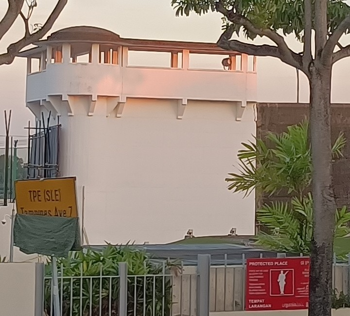

The old gaol was demolished in 2004, so its gallery is a short one: the inside of its cell door, one of its surviving turrets, and a banner on the wall of the complex that replaced it.

### The cell door from inside

*The inside face of an original 1930s Changi Prison cell door — the side that faced the prisoner in his cell — preserved at the National Museum of Singapore; the door's corridor face is in the post. (Jacklee, CC BY-SA 4.0, via Wikimedia Commons; photographed 2015)*

### A surviving turret

*One of the two corner turrets kept when the gaol was demolished, photographed in October 2025 from a passing bus on Upper Changi Road North; the red sign marks the complex as a protected place. Two of the original four turrets survive, with the entrance gate and 180 metres of wall. (GoAheadFan95, CC BY-SA 4.0, via Wikimedia Commons; photographed 2025, cropped)*

### The wall today

*A banner reading "Help remove the label of prejudice" on a wall of the present Changi Prison Complex in January 2009, in the years of the Yellow Ribbon Project, which campaigns for ex-offenders to be given a second chance. (penreyes, CC BY, via Wikimedia Commons; photographed 2009)*
