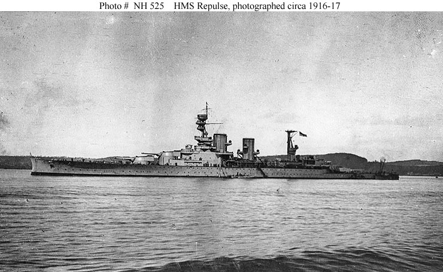

Two great ships in their last days: the battleship and the battlecruiser at Singapore, the battle photographed from the attacking aircraft, the battle as Japanese war art chose to remember it, and the ships as they were when they were young.

### The battle, seen whole

*The best-known photograph of the action, taken just after the first torpedo attack: Prince of Wales at the far left, Repulse beyond her, and a destroyer — Express or Electra — manoeuvring in the foreground. (US Navy photograph 80-G-413520, National Archives, public domain, via Wikimedia Commons)*

### The flagship at her berth

*HMS Prince of Wales moored at the Singapore Naval Base in her few days there, December 1941. She had fought the Bismarck in May and carried Churchill to his Atlantic meeting with Roosevelt in August; Singapore was her last port. (Royal Navy official photograph, public domain, via Wikimedia Commons)*

### Repulse as she was built

*HMS Repulse in 1916–17, newly completed — the speed and elegance that made the battlecruisers famous, and the light armour that made them vulnerable. A quarter of a century later she was still fast enough to dodge nineteen torpedoes. (US Naval History and Heritage Command NH 525, public domain)*

### The battle as Japan painted it

*"Sea Battle off Malaya" — Nakamura Kanichi's 1942 painting of the torpedo attacks, made as official war art. The painting ended the war in American hands; it is held by the US Army Signal Corps collection at the National Archives. (Public domain, via Wikimedia Commons)*
