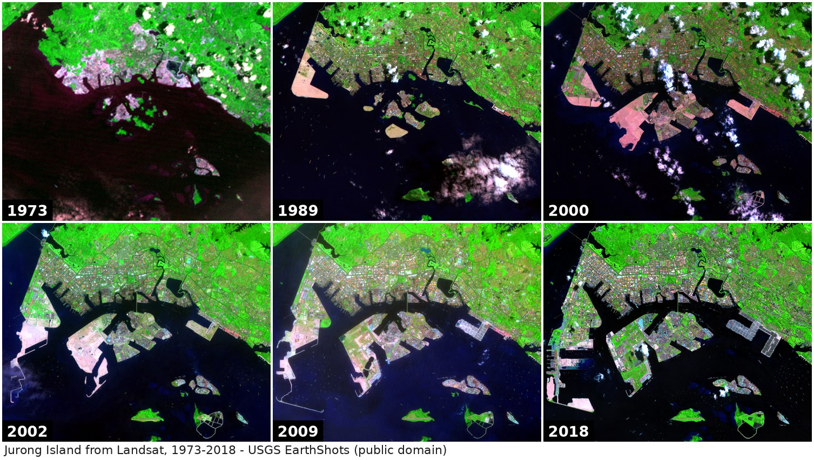

More photographs of Jurong Island — all taken from outside its fence, from the sea, the shore and Jurong Hill — and the satellite frames that show the seven islands becoming one.

### The merger in six frames

*Six Landsat frames at the same scale, 1973 to 2018: separate green islands, then bare reclamation sand, then one industrial island. (USGS EarthShots, Landsat 1/5/7/8, Public domain)*

### The island from outside the fence

*The merged island's shoreline from the sea in February 2011. (Jacklee, CC BY-SA 3.0, via Wikimedia Commons; photographed 2011)*

*Ships at anchor off the island at sunset, February 2011 — the anchorage is as close as most boats get. (Jacklee, CC BY-SA 3.0, via Wikimedia Commons; photographed 2011)*

*From the top of Jurong Hill Tower in 2021: tanks, plants and the strait the villages once fished. (Wzhkevin, CC BY-SA 4.0, via Wikimedia Commons; photographed 2021)*

*The Jurong Island Highway and the industrial estate in November 2006, while the last reclamation phases were still under way. (Sengkang, Copyrighted free use, via Wikimedia Commons; photographed 2006)*

### Power on the island

*PacificLight Power's station, photographed in 2015 — the 800-megawatt plant that began supplying the grid in 2014. (PLP2016, CC BY-SA 4.0, via Wikimedia Commons; photographed 2015)*

*The PacificLight plant up close. (Jeremy Foo, CC BY-SA 4.0, via Wikimedia Commons)*
