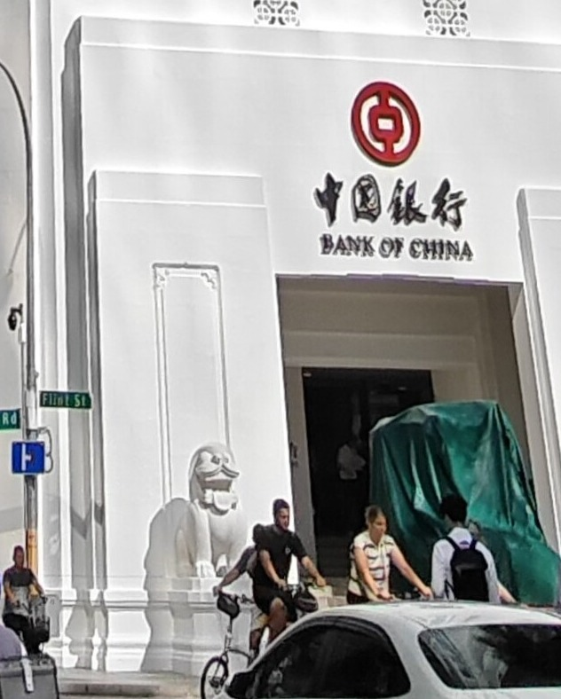

The corner of Battery Road and Flint Street across a hundred and twenty years of photographs — the palazzo as the Bank of China found it in 1937, the tower it replaced it with above the working river, and the two buildings that share the address today.

### The palazzo about 1908

*The Chartered Bank's building at Battery Road and Flint Street, opened in 1895, around 1908 — rusticated stonework below, Corinthian pilasters above, and the row of ornamental urns along the parapet. This is the building the Bank of China bought in 1937, never occupied, and demolished in 1947. (Unknown photographer, public domain, via Wikimedia Commons)*

### Battery Road about 1905

*Battery Road around 1905, with the Hongkong and Shanghai Bank, the Medical Hall and Gresham House, and the Tan Kim Seng Fountain at bottom left — the waterfront street of banks into which the Bank of China's branch would arrive, by way of Cecil Street, thirty years later. (G. R. Lambert and Co., public domain, via Wikimedia Commons)*

### The tower above the river, 1960

*The Singapore River in September 1960, crowded with bumboats, and the Bank of China Building standing over the far bank at the left — seven years after it opened, and already the landmark of the waterfront: the tallest building on the river, though never the tallest in Singapore. (Peter Forster, CC BY-SA 2.0, via Wikimedia Commons)*

### The 1953 block today

*The 1953 block from its own corner today — Battery Road and Flint Street, the same corner the palazzo stood on. The entrance still carries the bank's name in two scripts, and one of Rodolfo Nolli's pre-cast stone lions still stands guard beside the door. (DvTor8303, CC0, via Wikimedia Commons)*

### Two buildings, one bank

*The building today is two buildings: the 1953 block in front, and the 168-metre tower completed in 2000 rising directly behind it — Palmer and Turner's firm designing both, nearly half a century apart, the newer deliberately inheriting the older building's rising lines. (DvTor8303, CC0, via Wikimedia Commons)*

### The lion, up close

*One of Rodolfo Nolli's two pre-cast stone lions at the Flint Street entrance, close up — the bank's name in two scripts above the door, cyclists passing on Flint Street, and the second lion under wraps in green at the right. (Detail from a photograph by DvTor8303, CC0, via Wikimedia Commons)*
