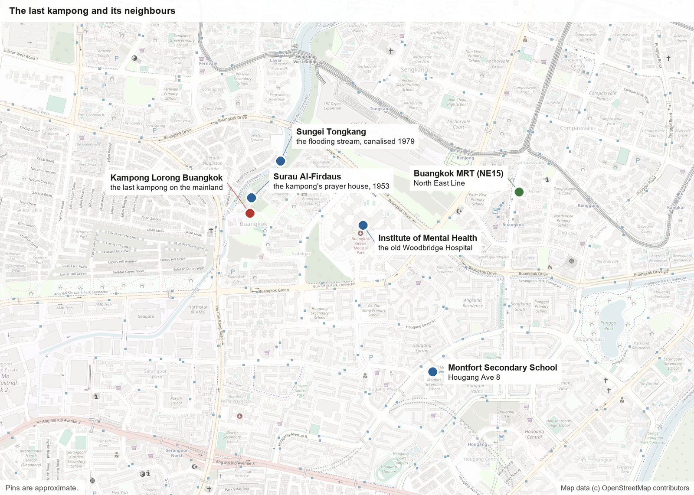

It survived. Every other kampong on the mainland is gone, but this one is still here — and as of 2024, the rent for some of its houses is $6.50 a month. The most anyone pays is $30. Those figures have not moved in about forty years, and if a tenant is short of money, the landlady will take rice or fruit instead. There are twenty-five families left — twelve Chinese, thirteen Malay — living in wooden houses with zinc roofs along earth lanes, behind the HDB blocks of Buangkok Green. The landlady is Sng Mui Hong, who was seventy-one when CNA profiled her in November 2024, and who has promised her late father that the kampong will not be sold. "As long as I have enough to live, that's already fine," she said. "There's no need to be greedy. Even if I get a lot of money, it will all be finished eventually." This is Kampong Lorong Buangkok, the last kampong on mainland Singapore — a village that was supposed to disappear with all the others, and didn't.

[← Back to all posts](/)

<!-- WATCH-WIDGET:BEGIN (generated by scripts/build_watch_widget.py - do not hand-edit between these markers, re-run the script instead) -->

  

    &#127911;
    Listen
  

  

    &#127916;
    Watch
  

<audio id="listen-audio" preload="none" style="display: none;">
  <source src="/audio/kampong-lorong-buangkok-the-last-kampong-on-the-mainland.mp3" type="audio/mpeg">
</audio>

  

  

    
  

  <button id="watch-close" aria-label="Close" style="position: absolute; top: 1em; right: 1.2em; color: #fff; font-size: 1.6em; cursor: pointer; background: none; border: none; z-index: 2;">&times;</button>
  

    <button id="watch-play" aria-label="Play/Pause" style="background: none; border: none; color: #fff; font-size: 1.4em; cursor: pointer; line-height: 1; padding: 0.2em;">&#10074;&#10074;</button>
    

      

    

    0:00 / 0:00
  

<!-- WATCH-WIDGET:END -->

*The way in — down an earth track behind the Buangkok Green flats, the mainland's last kampong. (Erwin Soo, CC BY 2.0, via Wikimedia Commons; photographed 2013)*

## A swamp, a medicine seller, and five or six families

The land — 12,248 square metres of it, roughly three football fields — was swamp when Sng Teow Koon bought it in 1956 from a Mr Huang Yu Tu. Sng sold traditional Chinese medicine for a living. Four to six houses already stood on the plot; he moved his own family in and began renting out parcels to other families to build on. In the earliest years there were just five or six households, Malay and Chinese, and the first work was the ground itself: residents hauled sand from the nearby estuary to fill the mud before they could build, and built each other's houses in the *gotong royong* way — your neighbours raise your walls, you raise theirs. Many of the first tenants worked close by, at Woodbridge Hospital (today's Institute of Mental Health) or on the rubber plantations of the district, and their descendants are still here.

By the 1960s the kampong held about forty families, its peak. Running water and electricity arrived in 1962. It also had a second name: Kampong Selak Kain — *selak kain*, "lift up your sarong" — because the low ground beside Sungei Punggol flooded so readily that residents hitched up their sarongs and waded. The floods never fully left; in March 2004 the kampong made headlines when heavy rain put it under water again, and officials judged full flood defences, costed at up to $10 million, impractical for a private village. Volunteers fenced the stream instead.

The village's prayer house, Surau Al-Firdaus, was first built in 1953 — before the Sng purchase — and rebuilt in 1967 and again in 1999, with a renovation in 2018. It still draws worshippers from outside the kampong as well as the families within, and holds religious classes. In 2004 the village headman, Awe Bin Ludin, looked after Muslim affairs — the surau, the prayer times, the Ramadan announcements, the collections for repairs and for bereaved families. Around the houses run the details every visitor remembers: chickens, cats and dogs roaming loose, jackfruit and banana and chilli and lime in the gardens, dirt tracks instead of roads, and old street signs carrying four-digit postal codes. One kept sign reads "Lorong Buang Kok 1954" — visitors constantly take 1954 for the year the kampong began, but it is the old postal code. The village is younger than its sign, and prouder of other dates.

*Surau Al-Firdaus, first built in 1953 and rebuilt in 1967 and 1999 — the kampong's prayer house still serves worshippers from beyond the village as well. (Muhammad Adrian, CC BY 2.0, via Wikimedia Commons; photographed 2025)*

## The decades that cleared every other kampong

Singapore spent the second half of the twentieth century rehousing a nation — the kampongs went, one by one, into the HDB new towns. Lorong Buangkok survived the great clearing for a plain legal reason and a human one. The legal reason: the land was private, bought and paid for, not state land awaiting a plan. The human reason is the family that owned it.

Sng Teow Koon died in 1997, and the land passed to his four children. The three elder siblings moved out to flats; the youngest, Mui Hong, stayed. She had promised her father she would preserve the kampong, and she runs it the way he did. The rents stay where they were — in 2007, the total she collected from every tenant came to about $300 a month. Nobody new has moved in since the 1990s: a house falls empty only when someone leaves or dies, and then it is offered only to people connected to the village or the family. The tenants own their houses; what they rent is the ground under them.

In 2007 the land was reported to be valued at $33 million, and the New Paper put her answer in a headline: "My family ties are not for sale." She said it herself, the same year: "I can never regain this feeling of simplicity and freedom, and be close to my childhood memories." Two years later, when the New York Times came to write about Singapore's last village, she explained the village she was keeping: "I have a deep attachment to my neighbours… After all they grew up with me, and some of the grandmothers and grandfathers here have watched me grow up. They are like my own parents because we are from the same village. So I don't care if they are Malay or Chinese."

## Fame, and its fences

Fame arrived slowly, then all at once. The 2004 flood put the kampong in the papers; the 2007 valuation made it a story about money refused; the Times made it world-famous in 2009; the BBC came in 2021. Documentary crews, school groups and weekend walkers followed. Guided tours — the sanctioned way in — fill to capacity, and since 2025 a Singapore Culture Pass tour has brought visitors down the earth track to meet Sng Mui Hong at her own home.

The attention has a price, and the residents pay it. Travel writers who once described gates left open now describe fences between plots, doors locked, curtains drawn — the village defending its privacy from its own celebrity. It is private residential land, not a museum: the lanes are open to a quiet walker, but the houses are people's homes, several of them elderly people's homes, and the tours exist partly so that visiting happens on the village's terms.

*A lived-in village house, verandah and outdoor table — the kampong today is a home first and an attraction second. (M. Adrian Jurhami, CC BY 4.0, via Wikimedia Commons; photographed 2026)*

## The future, drawn on a map

On paper, the kampong's future is already drawn. The site is divided in the Master Plan into four parcels: a major road toward Seletar, a primary school, a secondary school and a neighbourhood park. When the 2014 Master Plan set that out, there were public calls to conserve the village instead. In Parliament on 2 October 2017, MP Intan Azura Mokhtar asked for its preservation; the Second Minister for National Development, Desmond Lee, replied that redevelopment would likely come only "several decades later," tied to the long-term growth of Seletar. The kampong has no conservation status in law — its protection is, and has always been, its owners.

The residents took the minister's words the way they take most things. Mohamed Sulaiman, a long-time resident, said at the time: "If government say, can stay, 20 year – I very happy. I don't know I where, 100 over years already, but if can stay, I happy."

## The last kampong, for now

So the village goes on: twenty-five families, the surau's green roof, the mango trees that Sng Mui Hong talks to when her mood is bad — "When my mood isn't good, I can talk to [its] mango trees," she told CNA — and a rent book that would have made sense in 1986. Her advice, at seventy-one, was the kampong's philosophy in one breath: "Don't think so far ahead. The more you think, the worse it is for your brain. Just be a bit more open-minded, then you will have no problems in life."

*The last kampong and its neighbours, plotted on today's map. Pins are approximate. (Map data © OpenStreetMap contributors)*

[See more photos of the kampong in the gallery](/gallery/kampong-lorong-buangkok-the-last-kampong-on-the-mainland/)

**Where it fits in the bigger story:** Singapore's kampongs were not preserved by policy; they were cleared by it, almost to the last one. This one survives because a medicine seller bought a swamp in 1956, and because his youngest daughter decided that enough money was enough. When she is asked what the land is worth, she says she has had no direct offers and does not know or care — the most unusual sentence in Singapore property, and the reason a whole village is still standing at the end of an earth track behind the Buangkok flats.

A note of my own. I grew up in Aukang, and most of my life was lived within a few streets of this kampong - in Jalan Payoh Lai, in Jalan Teliti, in Jalan Tari Piring off Jalan Kayu, and in a rented house in Jalan Sindor, off Yio Chu Kang Road. I never thought of Buangkok as the last kampong, or even as a Malay village; it was just a road I knew. To a boy, the distance from Aukang to Jalan Kayu seemed too much ever to walk. It is about five miles - no more than the walk I now take around my neighbourhood in Maryland. On my next visit home, I intend to walk it.

---

**Sources:**

- National Library Board, Infopedia: [Kampong Lorong Buangkok](https://www.nlb.gov.sg/main/article-detail?cmsuuid=e1b16980-6628-4391-af99-2389c35150d1)
- Roots (National Heritage Board): [Surau Al-Firdaus, Lorong Buangkok](https://www.roots.gov.sg/places/places-landing/Places/surveyed-sites/Surau-Al-Firdaus-Lorong-Buangkok)
- Eunice Sng, TODAY/CNA, 23 November 2024: [Up Close: the co-owner of Singapore's last kampung](https://www.channelnewsasia.com/today/up-close/up-close-elderly-coowner-last-kampung-simple-life-not-sell-land-4760281)
- Samantha HuiQi Yow, BBC Travel, 25 May 2021: [Singapore's last surviving village](https://www.bbc.com/travel/article/20210525-singapores-last-surviving-village)
- Toh Ee Ming, TODAY, 2 October 2017: report of the parliamentary exchange on the kampong's redevelopment (via [republication](https://www.amkio.com/?p=14374))
- The Pride (Singapore Kindness Movement), 6 October 2017: [In search of Singapore's kampong spirit](https://pride.kindness.sg/in-search-of-singapores-kampong-spirit/)
- Bryna Sim, The Straits Times, 5 August 2007 (via [wildsingapore](http://www.wildsingapore.com/news/20070708/070805-1.htm))
- Seth Mydans, The New York Times, 3 January 2009: "Singapore prepares to gobble up its last village" (via [republication](https://punggolend.com/wp/?p=198))
- Defence Science and Technology Agency / GovTech, SG101: [Singapore's last kampong, Lorong Buangkok](https://www.sg101.gov.sg/resources/archives/singaporeslast-kampong-lorong-buangkok/)
- Wikipedia: [Kampong Lorong Buangkok](https://en.wikipedia.org/wiki/Kampong_Lorong_Buangkok) and [Surau Al-Firdaus](https://en.wikipedia.org/wiki/Surau_Al-Firdaus)
- Honeycombers: [Kampong Lorong Buangkok: the story of Singapore's last village](https://thehoneycombers.com/singapore/kampong-lorong-buangkok/)
- Photos: [entrance view](https://commons.wikimedia.org/wiki/File:Photo_Journal_(set)_-_Welcome_to_Kampung_Buangkok_(9723403703).jpg), [Surau Al-Firdaus](https://commons.wikimedia.org/wiki/File:Surau_Al_Firdaus_at_Kampong_Lorong_Buangkok_-_54292246824.jpg) and [its washing area](https://commons.wikimedia.org/wiki/File:Surau_Al_Firdaus_at_Kampong_Lorong_Buangkok_3.jpg), [village house with verandah](https://commons.wikimedia.org/wiki/File:Village_house_with_verandah_and_diner.jpg), [entrance sign](https://commons.wikimedia.org/wiki/File:Lorong_Buangkok_Singapore_signage.JPG), [a typical kampong house](https://commons.wikimedia.org/wiki/File:A_Typical_Kampong_House.JPG), [a village house](https://commons.wikimedia.org/wiki/File:Lorong_Buangkok_house.JPG), [an entrance door](https://commons.wikimedia.org/wiki/File:An_entrance_door_in_Kampong_Lorong_Buangkok.jpg), [electricity meter](https://commons.wikimedia.org/wiki/File:Photo_Journal_(Set)_-_A_power_supply_meter_to_a_wooden_kampung_house_(9682076337).jpg), [earthenware stove](https://commons.wikimedia.org/wiki/File:Photo_Journal_(set)_-_An_earthernware_stove_(9719616498).jpg), [chickens](https://commons.wikimedia.org/wiki/File:Photo_Journal_(Set)_-_Shoo!_(9695528234).jpg), [young explorers](https://commons.wikimedia.org/wiki/File:Photo_Journal_(Set)_-_Young_explorers_(9719102704).jpg) and [overgrown structure](https://commons.wikimedia.org/wiki/File:Photo_Journal_(Set)_-_Overgrown_(9685319060)_(2).jpg), all via Wikimedia Commons
- Map data © OpenStreetMap contributors

[← Back to all posts](/)
