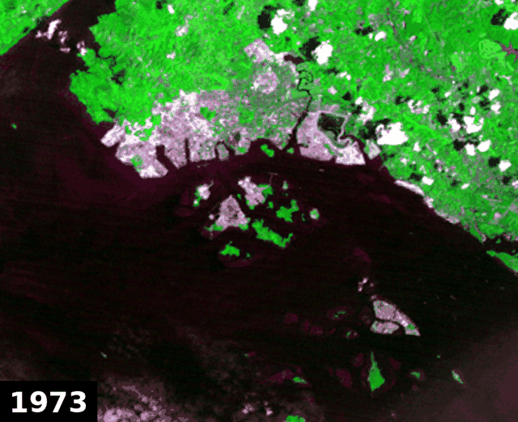

Almost every Singaporean depends on Jurong Island, and almost none will ever set foot on it. The petrol in the car, the gas that fires the power stations, the plastic in half the things at home — all of it passes through one hard-edged artificial island off Jurong, closed to the public, guarded, and visible only from a hill, a boat or the air. What is harder to remember is that the island is not one island at all. It is seven, joined by twenty years of reclamation into a single chemical fortress — and before the refineries, those seven islands held fishing villages whose headman's account of the strait is where this story has to start.

[← Back to all posts](/)

  &#127911;
  Listen
  <audio id="listen-audio" preload="none" style="display: none;">
    <source src="/audio/jurong-island-seven-islands-into-one.mp3" type="audio/mpeg">
  </audio>

*Jurong Island from the sea in February 2011 — one shoreline where seven islands used to be. (Jacklee, CC BY-SA 3.0, via Wikimedia Commons; photographed 2011)*

## The strait of nine

The channel between the islands and the Jurong mainland was called Selat Sembilan — the Strait of Nine. Ismail bin Mohd Ali, who had been penghulu, village head, of Pulau Ayer Merbau and the islands around it, explained the name by counting nine islands clustered there: Ayer Merbau, Ayer Chawan, Sakra, Bakau, Seraya, Merlimau, Meskol, Pesek and Mesemut Laut. His account was recorded in Berita Harian on 30 August 1981, less than a decade after he himself had been relocated to the mainland.

The puzzle is that the count does not hold. A British War Office map of 1939 shows fourteen islands in the strait, not nine. And the name is older than either count: on maps of about 1820 the strait appears as Sinbolan, Sambulan, Samulun or Semulun, and as long ago as 1889 the naturalist H. T. Haughton suggested that "Semulun" might be the name of an Orang Laut subgroup — in which case the Strait of Nine remembers not a number at all, but a people. The question is still open, and it is right to leave it open: the sea people's own geography was the first map of this place, and it survives mainly in names.

<em style="display: block; font-size: 0.8em; margin-top: 0.5em;">The islands as a 1945 map shows them: separate, named, and surrounded by water — with SELAT SEMBILAN written across the strait, and the kampongs marked on each island. (Terry Fitzpatrick, Public domain, via Wikimedia Commons)</em>

The seven islands that were eventually merged were Pulau Ayer Chawan, Pulau Ayer Merbau, Pulau Merlimau, Pulau Pesek, Pulau Pesek Kechil — a reef islet also called Terumbu Pesek — Pulau Sakra, itself an earlier joining of Sakra and Pulau Bakau, and Pulau Seraya. Smaller islets were absorbed along the way. Together the seven measured 991 hectares. Every one of them had been lived on, most for generations: Orang Laut groups — Seletar, Selat, and possibly the Semulun of the old maps — were there before 1819, the Orang Seletar building their pau kajang boats from seraya timber; Bugis settlers followed, farming and fishing; and the villages that lasted into living memory were Malay fishing kampongs of wooden stilt houses along palm-fringed shores.

*Where the seven islands lay: off Jurong, at Singapore's south-western corner. (Vsion, CC BY-SA 2.5, via Wikimedia Commons; created 2005)*

## The kampong world

The kampong names are the map of that lost world, and they reward reading slowly. Ayer Chawan held Kampong Wak Benchik, Wak Sekak and Wak Jiling. Ayer Merbau held Kampong Ayer Merbau, Kampong Bahru and Kampong Mak Boak, and a Muslim cemetery. Merlimau's villages were Tumbok Opih, Ayer Limau and Limau Manis — the lime names repeated, because the island was orchard country; a Teochew settler, Xu Xifan, came after the Second World War to grow fruit trees on a relative's land there. Seraya, the largest village island, had four kampongs — Tengah, Seraya, Pulau Kecil and Kubang Babi — a sacred keramat called Keramat Nenak, and another cemetery. Sakra's village was Tanah Merah; Pesek's was simply Kampong Pesek.

Some names keep their stories. "Ayer" means water, and marks the islands with fresh water on them: of Ayer Merbau's well, Ismail the penghulu said, "Even though it was shallow, the well never ran dry, and during the dry season, residents from nearby islands would come there to collect water." Ayer Chawan's name may remember the glass cups — chawan — that Bugis settlers kept digging up in their pineapple fields. Pesek's name has two offered explanations, Bugis holed coins or violin-playing gatherings — mengesek biola — and the honest position is that nobody now knows. Sakra's may come from kera, monkeys, or from the shikra bird.

Seraya's last penghulu was Hamzah Haji Hussein, whose family came from Bintan. His voice is kept by the National Archives' Oral History Centre, in the series "Communities of Singapore" — and the collecting is not finished: his son, Ali bin Hamzah, sat for an interview on 27 August 2024. The memory of the islands is still being gathered, a generation after the islands themselves ceased to exist.

## The oil companies arrive, island by island

Industry did not arrive all at once, and it did not arrive on an empty shore. In 1968 the government acquired the whole of Pulau Ayer Chawan and leased it to Esso, which paid for reclamation that grew the island from 0.73 to 1.54 square kilometres and built a S$200 million refinery on it. The refinery started up in 1970, at 90,000 barrels a day. The village island had become a refinery island in about two years.

Merlimau followed. The Singapore Petroleum Company, formed in 1969, brought its refinery on stream there in July 1973. After the first oil shock the small plant was no longer competitive, and in 1979 SPC joined BP and Caltex to form the Singapore Refining Company — SRC — to upgrade and expand it. SRC is still there, at 1 Merlimau Road, now a joint venture of Chevron and SPC, processing about 290,000 barrels a day: the merged island's road names still carry the old islands inside the fence.

The ambition widened in the 1980s. The Petrochemical Corporation of Singapore, founded in 1977 by the Singapore Government and a Japanese consortium led by Sumitomo Chemical, built its complex on Ayer Merbau, and in February 1984 brought Southeast Asia's first full-fledged ethylene plant on stream — the step from refining fuel to making the feedstocks of the chemical industry. On Seraya, merged in 1979 with the two Seburus islets at a cost of S$32.7 million and leased to the public utilities board, Stage 1 of Pulau Seraya Power Station was completed in 1988: Singapore's first offshore power station, its electricity carried to the mainland through a submarine cable tunnel 2.6 kilometres long and some 20 metres under the sea. The station, finished in stages by 1997, is now YTL PowerSeraya's.

<em style="display: block; font-size: 0.8em; margin-top: 0.5em;">Pulau Seraya Power Station, on the island that once held four kampongs — Singapore's first offshore power station, completed in stages from 1988. (YTL Power International Berhad, CC BY-SA 4.0, via Wikimedia Commons; photographed 2019)</em>

The islands had, in fact, already begun to merge, one industrial plot at a time: Ayer Merbau absorbed five small islets in 1976–77, Seraya took in the Seburus pair in 1979, Sakra and Bakau were joined in 1985. The great amalgamation of the 1990s only generalised what industry had started.

And the villages? Most islanders were rehoused in HDB flats on the mainland, with jobs provided, and the official history records both sides of it: an effort to keep communities together as long as possible, and residents who spoke of dislocation and the loss of a community. One group of islanders was resettled three times over — from Pulau Samulun to Pulau Merlimau for the building of Jurong Port, then to Tanjong Keling, and finally into HDB flats in Jurong. No source gives a total count of the people moved, and this post will not invent one. What survives is the shape of it: a whole seascape of villages, emptied within about a generation.

## The cost of the industry

On 25 October 1988, at about half past one in the afternoon, fire broke out at an SRC naphtha storage tank on Pulau Merlimau — a 120,000-barrel tank whose jammed floating roof was under repair. The fire spread to two neighbouring naphtha tanks and burned for about five days, until the morning of 30 October. It remains the worst refinery fire in Singapore's history. No lives were lost; twenty-five people were injured, most of them firefighters, five seriously. It was SRC's second major fire in four years. The big refinery fire many people remember, in September 2011, was at Pulau Bukom, not here — but Merlimau's five-day burn is the one that belongs to this island's story, and Jurong Island's first fire station followed in 1998, a second in 2008.

## Seven islands into one

The plan to amalgamate the seven islands was conceived in the 1980s; JTC became the responsible agent in 1991, and industry was signing before the island existed — DuPont, Jurong Island's first lessee, took its plot on Sakra in 1990. Reclamation began in 1995. Japan's Penta-Ocean Construction led the joint venture that won the Phase 3 contract — S$1.3 billion to reclaim 977 hectares, then the largest single reclamation contract ever awarded in Singapore.

The work finished on 25 September 2009, twenty years ahead of schedule. The seven islands' 991 hectares had become 3,000 hectares of new land — about 3,200 by 2015, after smaller additions. The road link came first: the Jurong Island Highway dates from March 1999, and the road link was officially opened on 10 February 2000. On 14 October 2000, Prime Minister Goh Chok Tong officially opened Jurong Island and called it a "Herculean achievement". By opening day, more than sixty companies and over S$20 billion in investments were already on the island, and over 6,000 people worked there.

The United States Geological Survey's Landsat satellites watched it happen. Their frames, all public domain, are the only honest before-and-after this post can offer — there are no copyright-clear photographs of the kampong era, and the reclamation itself was photographed mostly for official records. What the satellites saw needs no commentary:

*Seven islands into one, 1973–2018: the Landsat frames crossfade from separate green islands to a single chemical island. Pulau Bukom is at lower right throughout. (USGS EarthShots, Landsat 1/5/7/8, Public domain)*

## Underneath, and insurance

The island the satellites see is only the top layer. Beneath Banyan Basin, 130 metres under the seabed, five rock caverns — each 27 metres high, 20 metres wide and 340 metres long — hold 1.47 million cubic metres of crude oil, condensate, naphtha and gas oil. The Jurong Rock Caverns were officially opened on 2 September 2014: storage space Singapore did not have on the surface, dug out of the rock below the island it had built on the sea.

And on a 40-hectare plot at the island's southern tip stands the reason readers of this blog's pipelines story will know the island best. Until 2013, every molecule of Singapore's natural gas arrived by pipeline from Malaysia and Indonesia. The Singapore LNG terminal — decided in 2006, built for S$1.7 billion — began commercial operations on 7 May 2013 and was officially opened the following February. It is the insurance policy made concrete: a second way in for the fuel that makes about 95 per cent of Singapore's electricity, standing on an island that did not exist when the pipelines were laid.

## The island nobody can visit

In 2001 Jurong Island was gazetted a protected area, and it remains one. Entry requires a Jurong Island Pass, and a pass requires a sponsor — a company on the island must vouch for the visitor; there is no applying as an individual, no tour, no public day. Visitors enrol their biometrics and clear a checkpoint; the Army guards the land, the Police Coast Guard patrols the surrounding restricted waters, and photography inside is prohibited. More than a hundred energy and chemical companies now operate there, linked by over a hundred kilometres of shared pipelines, one plant's output feeding the next.

So every photograph in this post was taken from outside the fence — from Jurong Hill, from the mainland shore, from a boat. That is not a limitation the post can work around; it is part of the subject. Jurong Island is the most consequential place in Singapore that Singaporeans cannot see.

*The island at night from Jurong Hill in 2009 — the closest most people will ever get. (William Cho, CC BY-SA 2.0, via Wikimedia Commons; photographed 2009)*

## The reinvention

The island turned twenty-five in 2025, and the anniversary brought a change of direction rather than a celebration of scale. At the Jurong Island 25th Anniversary Dinner in November 2025, the refreshed plan was set out: a premier hub for specialty chemicals and sustainable materials, and a global testbed for new energies and low-carbon technologies. Output of sustainable products is up 1.4 times since 2019. On the island now: a bench-scale rig by IHI and A*STAR making sustainable aviation fuel from hydrogen and carbon dioxide; a consortium exploring low- or zero-carbon ammonia for power generation and bunkering; the island's largest solar array, about 120 megawatts-peak, from Sembcorp; a S$62 million low-carbon technology testbed opening in 2027; and about 20 hectares set aside for a low-carbon data centre park. The island built for oil is being retooled, carefully, for what comes after oil.

*The island in June 2026, from the sea — still behind its fence, still growing into its next purpose. (ZKang123, CC BY-SA 4.0, via Wikimedia Commons; photographed 2026)*

[See more photos…](/gallery/jurong-island-seven-islands-into-one/)

**Where it fits in the bigger story:** Singapore has made land before — but Jurong Island is the only time it made land out of other inhabited islands, villages and all, and then closed the result to the public forever. The seven islands are gone from the map and present everywhere in the island that replaced them: in 1 Merlimau Road, in Sakra and Seraya and Banyan, in a strait that is no longer called Sembilan. The penghulu's nine islands were really fourteen, and are now one — and the one is an island almost nobody will ever see.

---

**Sources:**

- [Jurong Island — Singapore Infopedia, National Library Board](https://www.nlb.gov.sg/main/article-detail?cmsuuid=ad9dd6c3-782d-474c-a632-92d57ba9e1e3)
- [Jurong Island is officially opened — National Library Board](https://www.nlb.gov.sg/main/article-detail?cmsuuid=a27a6821-9ee6-45c1-b3d1-0dce19252eed)
- [Jurong reclamation — National Library Board](https://www.nlb.gov.sg/main/article-detail?cmsuuid=ea7f0e25-22c4-4db0-acfd-723c87d73679)
- [Pulau Merlimau refinery fire — Singapore Infopedia, National Library Board](https://www.nlb.gov.sg/main/article-detail?cmsuuid=e4b1bb69-d4ba-407d-9528-eba0b39a7276)
- [Selat Sembilan: Orang Laut, Bugis, and the Place Names of Jurong's Lost Islands — Roots, National Heritage Board](https://www.roots.gov.sg/muse/articles/selat-sembilan-orang-laut-bugis-and-the-place-names-of-jurongs-lost-islands)
- [Jurong Island: Creating a World-Class Energy and Chemicals Hub — Centre for Liveable Cities, 2021](https://isomer-user-content.by.gov.sg/50/efc85ace-8d7f-41dd-b078-326ea896df77/uss-jurong-island.pdf)
- [Opening address by DPM Gan Kim Yong, Jurong Island 25th Anniversary Dinner — JTC](https://www.jtc.gov.sg/about-jtc/news-and-stories/press-releases/opening-address-by-dpm-gan-kim-yong)
- [How to enter Jurong Island — JTC](https://www.jtc.gov.sg/get-help/accessing-jurong-island/ji-pass)
- [History — Energy Market Authority](https://www.ema.gov.sg/about-ema/who-we-are/history)
- [Prime Minister Lee Hsien Loong officially opens Singapore LNG Terminal — Singapore LNG](https://www.slng.com.sg/prime-minister-lee-hsien-loong-officially-opens-singapore-lng-terminal)
- [PCS brochure 2024 — Petrochemical Corporation of Singapore](https://www.pcs.com.sg/wp-content/uploads/2024/05/PCS-Brochure_2024_final.pdf)
- [Singapore: key milestones — ExxonMobil](https://corporate.exxonmobil.com/locations/singapore/key-milestones)
- [Our journey — YTL PowerSeraya](https://ytlpowerseraya.com.sg/about-us/our-journey/)
- [Jurong, Singapore — USGS EarthShots](https://eros.usgs.gov/earthshots/jurong)
- Image file pages: [Jurong Island from the sea, 2011](https://commons.wikimedia.org/wiki/File:Jurong_Island,_Singapore_-_20110227-01.jpg), [the Jurong islands in 1945](https://commons.wikimedia.org/wiki/File:Singapore_-_Jurong_Islands_1945.jpg), [Jurong Island locator map](https://commons.wikimedia.org/wiki/File:Jurong_Island_locator_map.png), [Power Seraya Power Station](https://commons.wikimedia.org/wiki/File:Power_Seraya_Power_Station.jpg), [Jurong Island at night, 2009](https://commons.wikimedia.org/wiki/File:Aerial_view_of_Jurong_Island_from_Hill_top.jpg), [Jurong Island, June 2026](https://commons.wikimedia.org/wiki/File:Jurong_Island_June_2026.jpg), [Jurong Island from the sea, second frame, 2011](https://commons.wikimedia.org/wiki/File:Jurong_Island,_Singapore_-_20110227-02.jpg), [Ships near Jurong Island at sunset, 2011](https://commons.wikimedia.org/wiki/File:Ships_near_Jurong_Island,_Singapore,_at_sunset_-_20110227-01.jpg), [Jurong Island from Jurong Hill Tower, 2021](https://commons.wikimedia.org/wiki/File:Jurong_Island_viewed_from_the_top_of_Jurong_Hill_Tower.jpg), [PacificLight Power station, 2015](https://commons.wikimedia.org/wiki/File:PLPPowerPlant.jpg), [PacificLight Power plant](https://commons.wikimedia.org/wiki/File:PLPplant.jpg), [Jurong Industrial Estate and Jurong Island panorama, 2006](https://commons.wikimedia.org/wiki/File:Jurong_Industrial_Estate_and_Jurong_Island,_panorama,_Nov_06.jpg)

[← Back to all posts](/)
