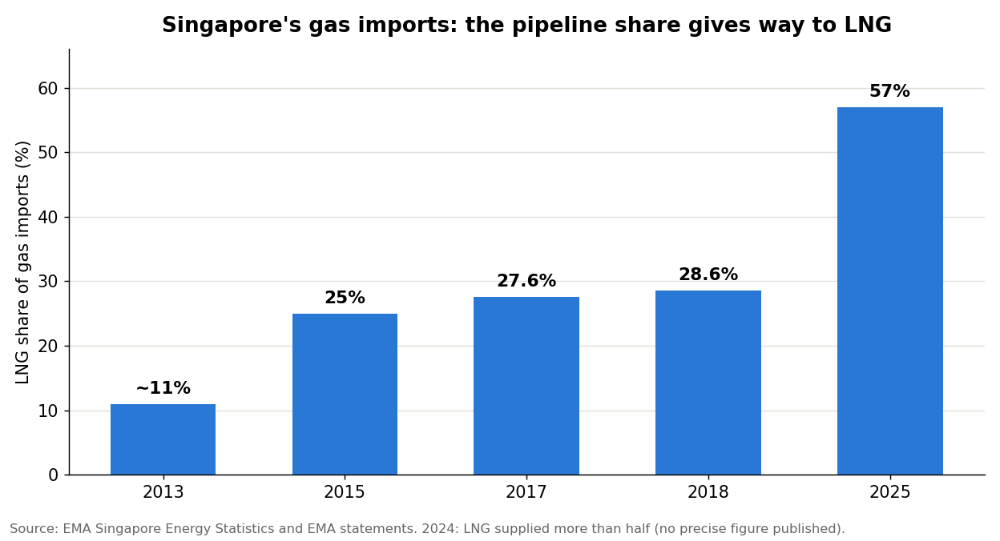

When Indonesia trimmed the pipeline gas it sends to Singapore in October 2026, the official answer took one sentence: more liquefied natural gas could be brought in at any time. That sentence rested on a terminal on Jurong Island that had been built thirteen years earlier, at a cost of S$1.7 billion, against exactly this day. This post is the story of that terminal — the companion piece to [The Pipelines That Feed Singapore](/2026/10/27/the-pipelines-that-feed-singapore/), which told the story of the pipes it insures against.

[← Back to all posts](/)

<!-- WATCH-WIDGET:BEGIN (generated by scripts/build_watch_widget.py - do not hand-edit between these markers, re-run the script instead) -->

  

    &#127911;
    Listen
  

  

    &#127916;
    Watch
  

  <a href="https://youtu.be/JrJwZuoKQiw" target="_blank" rel="noopener" aria-label="Watch this story as a video on YouTube" style="display: inline-flex; flex-direction: column; align-items: center; gap: 0.2em; text-decoration: none; color: inherit;">
    
      <svg width="1.4em" height="1.4em" viewBox="0 0 24 24" aria-hidden="true"><rect x="1" y="4" width="22" height="16" rx="5" fill="#FF0000"/><path d="M10 8.5l6 3.5-6 3.5z" fill="#fff"/></svg>
    
    YouTube
  </a>
  <a href="https://youtube.com/shorts/NL4IzC6Lkhw" target="_blank" rel="noopener" aria-label="Watch a short version of this story on YouTube Shorts" style="display: inline-flex; flex-direction: column; align-items: center; gap: 0.2em; text-decoration: none; color: inherit;">
    
      <svg width="1.4em" height="1.4em" viewBox="0 0 24 24" aria-hidden="true">
        <defs>
          <linearGradient id="shortsGradTheLngTerminald4ef" x1="0%" y1="0%" x2="100%" y2="100%">
            <stop offset="0%" stop-color="#FF0000"/>
            <stop offset="100%" stop-color="#FF4E8B"/>
          </linearGradient>
        </defs>
        <rect x="1" y="1" width="22" height="22" rx="7" fill="url(#shortsGradTheLngTerminald4ef)"/>
        <path d="M13 6 L7.5 13.5 H11.5 L10.5 18 L16.5 10 H12.5 Z" fill="#fff"/>
      </svg>
    
    Shorts
  </a>
  <a href="https://www.tiktok.com/@lesserknownsingapore/video/7712606908011547935" target="_blank" rel="noopener" aria-label="Watch a short version of this story on TikTok" style="display: inline-flex; flex-direction: column; align-items: center; gap: 0.2em; text-decoration: none; color: inherit;">
    
      <svg width="1.4em" height="1.4em" viewBox="0 0 24 24" aria-hidden="true">
        <rect x="1" y="1" width="22" height="22" rx="7" fill="#000"/>
        <path d="M13.2 5h2.3c.2 1.6 1.4 2.8 3 3v2.3a5.3 5.3 0 0 1-3-1v5.2a4.2 4.2 0 1 1-4.2-4.2h.4v2.4h-.4a1.8 1.8 0 1 0 1.9 1.8z" fill="#25F4EE" transform="translate(-0.6 -0.4)"/>
        <path d="M13.2 5h2.3c.2 1.6 1.4 2.8 3 3v2.3a5.3 5.3 0 0 1-3-1v5.2a4.2 4.2 0 1 1-4.2-4.2h.4v2.4h-.4a1.8 1.8 0 1 0 1.9 1.8z" fill="#FE2C55" transform="translate(0.6 0.4)"/>
        <path d="M13.2 5h2.3c.2 1.6 1.4 2.8 3 3v2.3a5.3 5.3 0 0 1-3-1v5.2a4.2 4.2 0 1 1-4.2-4.2h.4v2.4h-.4a1.8 1.8 0 1 0 1.9 1.8z" fill="#fff"/>
      </svg>
    
    TikTok
  </a>

<audio id="listen-audio" preload="none" style="display: none;">
  <source src="/audio/the-lng-terminal-the-insurance-policy-singapore-built-in-2013.mp3" type="audio/mpeg">
</audio>

  

  

    
  

  <button id="watch-close" aria-label="Close" style="position: absolute; top: 1em; right: 1.2em; color: #fff; font-size: 1.6em; cursor: pointer; background: none; border: none; z-index: 2;">&times;</button>
  

    <button id="watch-play" aria-label="Play/Pause" style="background: none; border: none; color: #fff; font-size: 1.4em; cursor: pointer; line-height: 1; padding: 0.2em;">&#10074;&#10074;</button>
    

      

    

    0:00 / 0:00
  

<!-- WATCH-WIDGET:END -->

*Jurong Island from the sea in February 2011, while the LNG terminal was under construction on its south-western shore. (Jacklee, CC BY-SA 3.0, via Wikimedia Commons)*

## All the eggs in two pipelines

By the middle of the 2000s, natural gas made about 80% of Singapore's electricity, and every bit of that gas arrived by pipeline — from Malaysia across the Johor Strait, and from Indonesia's West Natuna fields and South Sumatra, about 800 million cubic feet a day in all. The arrangement worked, but it had a shape that worried planners: two suppliers, three pipes, no alternative. A disruption to Indonesian supply in 2004 had already caused blackouts. The fields themselves would one day run down. And gas was still growing — the pipelines' share of the country's power was heading towards almost everything.

*The terminal's site, on the south-western shore of Jurong Island. (Map data © OpenStreetMap contributors)*

## The decision, 2006

On the 7th of August 2006, the Minister for Trade and Industry, Lim Hng Kiang, announced the decision at the first EMA Forum. "We need to diversify our energy sources in order to ensure that we are not over-reliant on a single source for our energy needs," he said. "As such, the Government has decided to import Liquefied Natural Gas." The plan was a terminal of 3 million tonnes a year, with the first gas flowing around 2012, built and run commercially. An investor search would follow.

LNG itself deserves a sentence, because the whole story hangs on what it makes possible. Natural gas cooled to about minus 162 degrees turns liquid and shrinks to roughly one six-hundredth of its volume. In that form it can be loaded onto a ship anywhere on earth and unloaded anywhere else. A pipeline ties you to whoever is at the other end of it. LNG unties you — the supplier becomes whoever has a cargo to sell.

## How the chain works

An LNG trade has three links, and they are partners, not rivals. At the export end, a liquefaction plant does the cooling and the loading — Norway's Melkøya plant, in the photograph below, or Canada's new plant at Kitimat, which shipped its first cargo only in 2025. In the middle, the tanker carries the liquid, kept cold in insulated tanks. At the import end, a receiving terminal stores the liquid and warms it back into gas for the local network. Singapore's terminal is the third kind. Its floating counterpart, a storage and regasification ship moored at a berth, does the same import job afloat — a distinction that matters later in this story, when Singapore ordered one of those too.

*The export end of the chain: the liquefaction plant on Melkøya island, Hammerfest, Norway, where gas from the Snøhvit field is cooled into liquid and loaded onto tankers. (Virtual-Pano, CC BY-SA 4.0, via Wikimedia Commons)*

## The commercial attempt, and the takeover

The commercial version came first. PowerGas, Singapore Power's gas arm, was designated to own and run the terminal in 2007 and appointed its developer in April 2008. The same month, the Energy Market Authority appointed BG Asia Pacific as the LNG aggregator — the company licensed to bring in and sell up to 3 million tonnes a year of regasified LNG, drawn from BG's worldwide portfolio, for up to twenty years.

Then the global financial crisis arrived, and the sums stopped working. On the 30th of June 2009, Second Minister S Iswaran announced that the Government would take over the terminal's development and ownership, "as it was difficult to proceed with the project on a commercial basis." The EMA incorporated a new company, Singapore LNG Corporation — SLNG — to build, own and operate it, holding the shares in trust. Prime Minister Lee Hsien Loong, looking back at the opening five years later, put the reasoning plainly: "The project became too risky for any private operator to carry. But we believed that it was in Singapore's strategic interests to proceed, and we decided that the Government would take over."

## The build

Samsung C&T won the construction contract in February 2010, and ground was broken on the 31st of March that year, on about thirty hectares at the south-western end of Jurong Island. The design grew while it was being built: a third storage tank, decided in November 2010, lifted the planned throughput from 3.5 to 6 million tonnes a year. A secondary berth project reclaimed about ten more hectares beside it. The overall project cost came to S$1.7 billion.

The terminal took two first cargoes, and they are worth keeping separate. The first cargo of any kind was a commissioning cargo: bought by SLNG directly from Qatargas, loaded at Ras Laffan in Qatar, and delivered on the 27th of March 2013 by the Umm Slal — a Q-Max, then the largest type of LNG ship in the world — to cool the tanks down and prove the plant. Commercial operations began six weeks later, on the 7th of May 2013, with BG's first cargo, carried by the Methane Kari Elin. The terminal that opened for business had two storage tanks of 180,000 cubic metres each, one jetty, and a throughput of 3.5 million tonnes a year.

*The Mozah, lead ship of the Q-Max class, at Ras Laffan in Qatar. The commissioning cargo of March 2013 arrived on a ship of this class, from this port. (Nakilat, CC BY-SA 4.0, via Wikimedia Commons)*

## The opening, 2014

By the time Prime Minister Lee officially opened the terminal on the 25th of February 2014, the third tank was in service and throughput stood at 6 million tonnes a year; the secondary jetty followed a month later. His speech is where the insurance idea lives, though he never used the word. The terminal, he said, "greatly increases our options and enhances our energy security," and building capacity ahead of demand "will give us a strategic buffer." He looked further ahead still: "We are preparing for the possibility that our demand for natural gas may one day be met entirely by liquefied natural gas." At the same opening he announced a fourth tank, and studies for a second terminal. He also noted the site's ceiling — Jurong Island could hold seven tanks and about 15 million tonnes a year, "but that is the limit, because of land constraints."

## The growth

The fourth tank, added under a S$700 million third phase, holds 260,000 cubic metres — one of the largest LNG storage tanks in the world — and entered service in 2018. The terminal today has four tanks holding 800,000 cubic metres in all, two jetties able to take the largest LNG ships afloat, and a regasification plant rated at an average of 9 million tonnes a year, with a peak of up to 11 million. SLNG's own summary of what that means is the policy in one line: if required, the terminal has sufficient capacity to meet all of the country's present natural gas demand.

Around that core job, a side business grew. Trucks began loading LNG at the terminal in April 2017 — the five-thousandth truckload left in June 2024. Small ships reload there for the region; Singapore's first LNG bunker vessel, the FueLNG Bellina, took its first load from the terminal in March 2021, and more than a hundred bunker reloads followed in 2024 alone. By the end of September 2023 the terminal had received about 430 cargoes.

The balance of supply shifted underneath it all. In 2013, LNG made up about 11% of Singapore's gas imports. By 2025 it was 57% — the pipelines, for the first time, were the smaller half.

*LNG's share of Singapore's natural gas imports. The crossover came in 2024, when LNG supplied more than half for the first time.*

*An LNG carrier in Singapore waters, seen from Sembawang. (Encik Tekateki, CC BY-SA 4.0, via Wikimedia Commons)*

## The payout, 2021

Insurance is only interesting when it is claimed on, and this policy was claimed on once before 2026 — at a price. From the 6th of September to the 26th of December 2021, upstream problems in West Natuna curtailed the pipeline supply, and low pressure from South Sumatra added to the shortfall in the last quarter. The power stations made up the difference the way the terminal was built to let them: as the Ministry of Trade and Industry later told Parliament, they "had to purchase more spot LNG at elevated global gas prices to make up for the drop in PNG supplies."

The lights stayed on. The bill arrived instead. World gas prices had risen about fivefold since March 2021; Singapore's wholesale electricity price averaged S$491 per megawatt-hour in October 2021, against S$78 to S$104 earlier that year. Six electricity retailers left the market that quarter, and the regulated household tariff climbed to a peak of 30.17 cents per kilowatt-hour in the third quarter of 2022. The episode taught the precise lesson the terminal embodies: LNG insures the *route* of supply, not its *price*. A cargo can always be bought — the terminal guarantees a door to bring it through — but in a panic, the world charges what it charges.

The system adjusted around the lesson. A Standby LNG Facility, a reserve stock arrangement managed by SLNG, was set up in October 2021 and made permanent a year later. And in October 2023 the government announced the deeper change: gas buying for the power sector would be centralised in a single national buyer.

*The import end of the chain, elsewhere: South Hook in Wales, one of Europe's largest LNG receiving terminals and, like Singapore's, a landing point for Qatari gas. (M J Roscoe, CC BY-SA 2.0, via Wikimedia Commons)*

## One buyer, and a second door

Singapore GasCo was established in April 2025, fully government-owned, under chief executive Alan Heng — the single company that now buys gas for the power stations, pooling their demand to sign longer contracts with more diverse suppliers. It is the commercial half of the insurance: the terminal is the physical door, GasCo is the standing arrangement for walking through it.

The second door is on its way. Announced in October 2023, Singapore's second LNG terminal will not be a bigger version of the first. It is a floating terminal — an FSRU, a ship that stores LNG and regasifies it aboard — owned and operated by Mitsui O.S.K. Lines, built by Hanwha Ocean in South Korea with 204,000 cubic metres of storage and 5 million tonnes a year of capacity, and moored not at Jurong Island but at Jurong Port, on the mainland shore. Its steel was cut in October 2025, its keel laid in May 2026, and the onshore works to connect it began at Jurong Port in March 2026. It is due in service by the end of the decade, taking the two terminals together to up to 15 million tonnes a year. The first terminal is still growing in its own way: in October 2026 SLNG broke ground on a third jetty, for the smaller ships of the bunkering trade.

*The FSRU Independence in Klaipėda, Lithuania — the same kind of ship Singapore has ordered for its second terminal: storage and regasification in one hull, moored at a berth. (AB Klaipėdos Nafta, CC BY-SA 4.0, via Wikimedia Commons)*

## October 2026

Which brings the story back to where it began. When Indonesia's regulator cut pipeline deliveries on the 24th of October 2026 — about 31 million cubic feet a day, redirected to power stations on Batam, Bintan and Sumatra after a long blackout — the EMA's response the same evening was that Singapore GasCo "is operationally ready to import more at any time," and Prime Minister Lawrence Wong pointed to the LNG terminals as the reason the country could cope. No emergency purchase was ever announced, and none may have been needed: the cut came to under 2% of a day's gas demand. That is what a mature insurance policy looks like from outside. Nothing happens, expensively, for years — and then, on the one day it is needed, nothing happening is the point.

*The demand end of the story: PacificLight's gas-fired power station on Jurong Island. (Jeremy Foo, CC BY-SA 4.0, via Wikimedia Commons)*

[See more photos…](/gallery/the-lng-terminal-the-insurance-policy-singapore-built-in-2013/)

**Where it fits in the bigger story:** Singapore has never had fuel of its own — not the coal, not the oil, not the gas — so its energy history is a history of doors: how many ways in, from how many directions, under whose control. The pipelines made three doors, all opening onto two neighbours. The terminal on Jurong Island was the first door that opened onto the whole world, and it cost S$1.7 billion precisely because it might never be strictly needed. The pipelines post tells how the gas arrives. This one is about the door that was built in case it stopped.

---

**Sources:**

- [Minister Lim Hng Kiang at the EMA Forum, 7 August 2006, Ministry of Trade and Industry](https://www.mti.gov.sg/newsroom/minister-lim-hng-kiang-at-the-ema-forum)
- [Energy Market Authority appoints BG Asia Pacific as LNG aggregator, EMA, April 2008](https://www.ema.gov.sg/content/dam/corporate/news/media-releases/2008/1254365125ENERGY%20MARKET%20AUTHORITY%20APPOINTS%20BG%20ASIA%20PACIFIC%20PTE%20LIMIT.pdf.coredownload.pdf)
- [Singapore's LNG terminal starts commercial operations, SLNG/EMA/MTI, May 2013](https://www.slng.com.sg/press-releases/singapores-lng-terminal-starts-commercial-operations)
- [Singapore's LNG terminal starts commercial operations, EMA, May 2013](https://www.ema.gov.sg/news-events/news/media-releases/2013/singapores-lng-terminal-starts-commercial-operations)
- [SLNG awards EPC contract for Secondary Berth Project, SLNG](https://www.slng.com.sg/press-releases/slng-awards-epc-contract-for-secondary-berth-project)
- [Q-Max LNG carrier Umm Slal delivers first cargo to Singapore, Offshore Energy, April 2013](https://www.offshore-energy.biz/2013/04/02/q-max-lng-carrier-umm-slal-delivers-first-cargo-to-singapore)
- [Prime Minister Lee Hsien Loong officially opens the Singapore LNG Terminal, SLNG, February 2014](https://www.slng.com.sg/prime-minister-lee-hsien-loong-officially-opens-singapore-lng-terminal)
- [Transcript of PM Lee's speech at the official opening, Prime Minister's Office](https://www.pmo.gov.sg/newsroom/transcript-speech-prime-minister-lee-hsien-loong-official-opening-liquefied-natural-gas/)
- [SLNG Terminal Overview, Singapore LNG Corporation](https://www.slng.com.sg/slng-terminal-overview)
- [SLNG Key Milestones, Singapore LNG Corporation](https://www.slng.com.sg/key-milestones)
- [Catalysing the LNG Ecosystem and the Energy Transition, SLNG](https://www.slng.com.sg/stories/catalysing-lng-ecosystem-and-energy-transition)
- [Gas, Energy Market Authority](https://www.ema.gov.sg/our-energy-story/energy-market-landscape/gas)
- [Natural Gas, Ministry of Energy, Trade and Industry](https://www.meti.gov.sg/energy-and-carbon/energy-supply/natural-gas/)
- [Singapore Energy Statistics, chapter 2, Energy Market Authority](https://www.ema.gov.sg/resources/singapore-energy-statistics/chapter2)
- [Written reply to Parliamentary Questions on natural gas, MTI](https://www.meti.gov.sg/newsroom/written-reply-to-pqs-on-natural-gas/)
- [Ministerial statement on energy security, Second Minister Tan See Leng, 4 April 2022, MTI](https://www.mti.gov.sg/newsroom/ministerial-statement-by-second-minister-for-trade-and-industry-dr-tan-see-leng-for-parliament-sitting-on-4-april-2022)
- [Pre-emptive measures to enhance Singapore's energy security and resilience, EMA, October 2021](https://www.ema.gov.sg/news-events/news/media-releases/2021/pre-emptive-measures-to-enhance-singapores-energy-security-and-resilience)
- [Centralising gas procurement for Singapore's power sector, EMA, October 2023](https://www.ema.gov.sg/news-events/news/media-releases/2023/centralising-gas-procurement-for-singapore-power-sector)
- [Establishment of Singapore GasCo, EMA, May 2025](https://www.enlit-asia.com/latest-news/establishment-singapore-gasco)
- [SLNG to develop, own and operate second LNG terminal in Singapore, SLNG, October 2023](https://www.slng.com.sg/press-releases/slng-to-develop-own-and-operate-second-lng-terminal-in-singapore-as-it-marks-10-years-of-commercial-operations)
- [SLNG inks agreements with MOL, Jurong Port and Wood for the second LNG terminal, SLNG, October 2024](https://www.slng.com.sg/press-releases/slng-inks-agreements-with-mol-jurong-port-and-wood-for-development-of-second-lng-terminal-in-singapore)
- [Construction of the FSRU for Singapore's second LNG terminal begins, SLNG](https://www.slng.com.sg/construction-of-the-FSRU-for-Singapores-second-LNG-terminal-begins)
- [Building the link behind Singapore's second LNG terminal, SLNG, March 2026](https://www.slng.com.sg/building-the-link-behind-singapore-second-lng-terminal)
- [SLNG begins construction of third jetty, SLNG, October 2026](https://www.slng.com.sg/press-releases/slng-begins-construction-of-third-jetty)
- [Singapore's power prices may rise on US-Iran conflict (EMA figures via Argus), Argus Media](https://www.argusmedia.com/en/news-and-insights/latest-market-news/2796677-singapore-s-power-prices-may-rise-on-us-iran-conflict)
- [Jurong Island from the sea, 2011 — photo file page, Wikimedia Commons](https://commons.wikimedia.org/wiki/File:Jurong_Island,_Singapore_-_20110227-02.jpg)
- [Mozah, Nakilat's flagship vessel — photo file page, Wikimedia Commons](https://commons.wikimedia.org/wiki/File:Mozah,_Nakilat%27s_flagship_vessel.JPG)
- [Melkøya LNG terminal at twilight — photo file page, Wikimedia Commons](https://commons.wikimedia.org/wiki/File:07647_NOR_Hammerfest_Melkoya_LNG_Terminal_V-P.jpg)
- [LNG carrier seen from Sembawang — photo file page, Wikimedia Commons](https://commons.wikimedia.org/wiki/File:Kapal_Pengangkut_LNG_dilihat_dari_Sembawang.jpg)
- [South Hook LNG terminal — photo file page, Wikimedia Commons](https://commons.wikimedia.org/wiki/File:South_Hook_LNG_terminal_above_Little_Wick_-_geograph.org.uk_-_8315622.jpg)
- [FSRU Independence in Klaipėda — photo file page, Wikimedia Commons](https://commons.wikimedia.org/wiki/File:FSRU_Independence_in_the_port_of_Klaip%C4%97da,_Lithuania.jpg)
- [PacificLight power plant — photo file page, Wikimedia Commons](https://commons.wikimedia.org/wiki/File:PLPplant.jpg)

[← Back to all posts](/)
