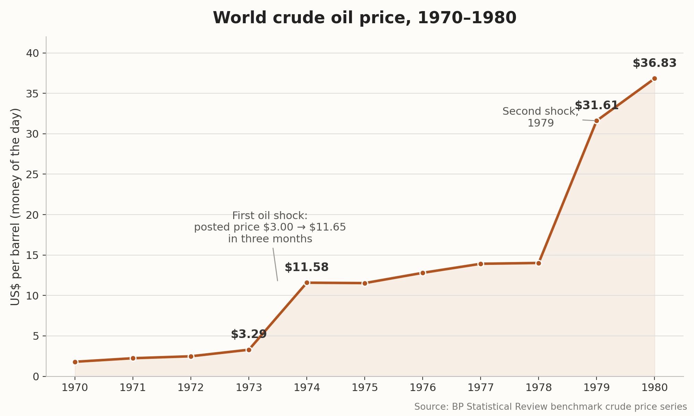

In the winter of 1973, Singapore's lights did not go out — and that was not luck. The island had no oil of its own, yet it refined other people's oil on a world scale and burned imported oil for every unit of its electricity. When the Arab oil producers cut production and the price of crude quadrupled in three months, Singapore's response was a strange one: it refused to help itself to the oil sitting in its own tanks, taxed its own motorists hard, and asked everyone to save a litre a day. The lights were turned down deliberately, by policy — and only just a little.

[← Back to all posts](/)

<!-- WATCH-WIDGET:BEGIN (generated by scripts/build_watch_widget.py - do not hand-edit between these markers, re-run the script instead) -->

  

    &#127911;
    Listen
  

  

    &#127916;
    Watch
  

  <a href="https://youtu.be/pQDBrrWHhsI" target="_blank" rel="noopener" aria-label="Watch this story as a video on YouTube" style="display: inline-flex; flex-direction: column; align-items: center; gap: 0.2em; text-decoration: none; color: inherit;">
    
      <svg width="1.4em" height="1.4em" viewBox="0 0 24 24" aria-hidden="true"><rect x="1" y="4" width="22" height="16" rx="5" fill="#FF0000"/><path d="M10 8.5l6 3.5-6 3.5z" fill="#fff"/></svg>
    
    YouTube
  </a>
  <a href="https://youtube.com/shorts/vVsdc568ruQ" target="_blank" rel="noopener" aria-label="Watch a short version of this story on YouTube Shorts" style="display: inline-flex; flex-direction: column; align-items: center; gap: 0.2em; text-decoration: none; color: inherit;">
    
      <svg width="1.4em" height="1.4em" viewBox="0 0 24 24" aria-hidden="true">
        <defs>
          <linearGradient id="shortsGrad1973TheOilbddf" x1="0%" y1="0%" x2="100%" y2="100%">
            <stop offset="0%" stop-color="#FF0000"/>
            <stop offset="100%" stop-color="#FF4E8B"/>
          </linearGradient>
        </defs>
        <rect x="1" y="1" width="22" height="22" rx="7" fill="url(#shortsGrad1973TheOilbddf)"/>
        <path d="M13 6 L7.5 13.5 H11.5 L10.5 18 L16.5 10 H12.5 Z" fill="#fff"/>
      </svg>
    
    Shorts
  </a>
  <a href="https://www.tiktok.com/@lesserknownsingapore/video/7712871373630197023" target="_blank" rel="noopener" aria-label="Watch a short version of this story on TikTok" style="display: inline-flex; flex-direction: column; align-items: center; gap: 0.2em; text-decoration: none; color: inherit;">
    
      <svg width="1.4em" height="1.4em" viewBox="0 0 24 24" aria-hidden="true">
        <rect x="1" y="1" width="22" height="22" rx="7" fill="#000"/>
        <path d="M13.2 5h2.3c.2 1.6 1.4 2.8 3 3v2.3a5.3 5.3 0 0 1-3-1v5.2a4.2 4.2 0 1 1-4.2-4.2h.4v2.4h-.4a1.8 1.8 0 1 0 1.9 1.8z" fill="#25F4EE" transform="translate(-0.6 -0.4)"/>
        <path d="M13.2 5h2.3c.2 1.6 1.4 2.8 3 3v2.3a5.3 5.3 0 0 1-3-1v5.2a4.2 4.2 0 1 1-4.2-4.2h.4v2.4h-.4a1.8 1.8 0 1 0 1.9 1.8z" fill="#FE2C55" transform="translate(0.6 0.4)"/>
        <path d="M13.2 5h2.3c.2 1.6 1.4 2.8 3 3v2.3a5.3 5.3 0 0 1-3-1v5.2a4.2 4.2 0 1 1-4.2-4.2h.4v2.4h-.4a1.8 1.8 0 1 0 1.9 1.8z" fill="#fff"/>
      </svg>
    
    TikTok
  </a>

<audio id="listen-audio" preload="none" style="display: none;">
  <source src="/audio/1973-the-oil-shock-and-the-winter-singapore-turned-down-the-lights.mp3" type="audio/mpeg">
</audio>

  

  

    
  

  <button id="watch-close" aria-label="Close" style="position: absolute; top: 1em; right: 1.2em; color: #fff; font-size: 1.6em; cursor: pointer; background: none; border: none; z-index: 2;">&times;</button>
  

    <button id="watch-play" aria-label="Play/Pause" style="background: none; border: none; color: #fff; font-size: 1.4em; cursor: pointer; line-height: 1; padding: 0.2em;">&#10074;&#10074;</button>
    

      

    

    0:00 / 0:00
  

<!-- WATCH-WIDGET:END -->

*A Singapore street in 1973/74: shophouses, laundry poles and crowds — the city as the oil shock reached it. (Rainer Halama, CC BY-SA 4.0, via Wikimedia Commons)*

## An island that ran on oil

By 1973 Singapore was one of the world's top three refining and trading centres, alongside Houston and Rotterdam. Four refineries had been built in just over a decade: Shell's on Pulau Bukom, opened in 1961; Esso's on Pulau Ayer Chawan in 1970, starting at 90,000 barrels a day; Mobil's on the Jurong coast; and the Singapore Petroleum Company's plant on Pulau Merlimau, which came on stream in July 1973 — months before the shock. Together the refineries contributed more than 30 percent of total manufacturing output. They imported crude from the Middle East, Africa and Asia, refined it, and shipped most of it out again; in the course of the 1970s the island's refining capacity reached a million barrels a day.

Almost everything else ran on the same barrel. BP's Singapore marketing manager, Colin Horn, put it plainly in 1973: "About 98% of our energy resources are derived from oil. All our electricity is generated from oil. Town gas and bottle gas is also obtained from oil... almost the entire economy of the country runs on oil." A country with no oil, whose whole economy ran on it, was about to find out what that meant.

*The Singapore River in 1973/74: shophouse rooftops in front, the growing city behind. (Rainer Halama, CC BY-SA 4.0, via Wikimedia Commons)*

*Pulau Bukom from Sentosa: Shell's refinery island, the first and largest of the four plants that made Singapore an oil centre. (Terence Ong, CC BY 2.5, via Wikimedia Commons)*

## October 1973: the taps turn

When war came to the Middle East in October 1973, the Arab oil-exporting countries cut production — by a quarter at the peak measure — and embargoed the United States, the Netherlands and a few others. Singapore was not a named target. Its exposure came through the world market: less crude being produced anywhere, and a price that climbed out of sight. The posted price of crude went from $3.00 a barrel to $5.11 within October, and to $11.65 at the producers' Tehran meeting in January 1974 — roughly four times higher in three months.

<em style="display: block; font-size: 0.8em; margin-top: 0.5em;">Sheikh Ahmed Zaki Yamani, Saudi Arabia's oil minister, the public face of the embargo. (Central Intelligence Agency, Public domain, via Wikimedia Commons)</em>

The embargo's public face was Saudi Arabia's oil minister, Sheikh Ahmed Zaki Yamani, and its instrument was the production cut as much as the embargo list: a quarter of the world's oil supply politics had changed in a month. For a refining island, the question was not whether Singapore would be embargoed. It was how much crude would still arrive, and at what price.

*The price of crude oil across the 1970s: the two steps up are the two shocks. (Chart by Seven (Muse), from the BP Statistical Review benchmark price series)*

## What the cables said

The squeeze, as it reached Singapore, is recorded week by week in the American embassy's cables home, now declassified. On 8 November 1973 the embassy reported that the Arab cutbacks "will probably result in 10 percent decrease in oil supplies throughout region according to local refineries". A joint Industry-Government Committee on petroleum supply had been set up under the Finance Ministry's Permanent Secretary, Ngiam Tong Dow, and the government was drawing up a contingency plan against a serious shortage.

The next day's cable was blunter: the American oil companies expected a cutback of 10 to 20 percent in crude supplies to Singapore-based refineries, though nobody could say when it would start. The newest refinery, SPC, was a joint venture of Amoco, the Summit group and the Development Bank of Singapore, and it had no crude of its own — for its first nine months it had relied on its partners' supply, and it feared being cut off altogether. Singapore's Foreign Minister planned to approach Kuwait and Saudi Arabia to ask that Singapore be put on a "good guy list" and allowed full shipments, pointing out that SPC's products supplied Malaysia, Bangladesh and Indonesia as well.

At the sharpest point, the arithmetic ran through the Aramco partners. A 35 percent cutback of Saudi crude to Exxon was expected to mean a 5 to 10 percent reduction in supplies to Esso's Singapore refinery. Saudi Arabia was also insisting that refineries receiving its crude must not supply American military requirements — and Esso Singapore duly terminated its bunkering and shipments to United States military customers, pleading force majeure. Singapore, for its part, made clear it did not want refined products shipped on to embargoed destinations through its port. In the embassy's shorthand, the government "did not want Singapore to be another Rotterdam".

By 29 November the line had hardened into a principle. The government, the embassy reported, had advised the oil companies to "not do a thing" that might jeopardise Singapore's non-aligned status — and the companies readily agreed. The same day, Shell told the embassy it could provide neither jet fuel for the aircraft of Governor Ronald Reagan, in Singapore as a presidential envoy, nor any fuel for United States military aircraft; some 10 to 15 itinerant aircraft a month that landed to refuel could not be refuelled. (Reagan's aircraft was, in the end, refuelled.) The cable added a warning that reached beyond Singapore: the ASEAN partners who took Singapore's refined products "would be seriously affected" if Arab crude supplies were sufficiently reduced.

## The oil in the tanks

The hardest decision of that winter concerned the oil already in Singapore. The refineries' tanks held stocks that, on paper, could have kept the island supplied for a long time. Lee Kuan Yew later described the choice in his memoirs: "Within days of the oil crisis in October 1973, I decided to give a clear signal to the oil companies that we did not claim any special privilege over the stocks of oil they held in their Singapore refineries. If we blocked export from those stocks, we would have enough oil for our own consumption for two years, but we would have shown ourselves to be completely undependable."

The "two years" figure is Lee's own, from his memoir; no contemporary document puts a number on it. But the decision itself is part of the official record, retold by Foreign Minister Vivian Balakrishnan in 2018: the government told the oil majors "we are not going to touch a single drop of oil in those oil tanks that belong to the multinational oil majors. And if we need anything, we will buy it from you at the full market price." Put the two halves of that winter together and the position was exact: no special privilege for Singapore itself — and no help for anyone else in evading the embargo either. The island would take its share of the cut along with the rest of the world, and pay the world price.

## The answer at home: tax, exhort, save a litre a day

What Singapore did not do is as striking as what it did. There was no rationing, and no lowering of speed limits. Looking back in an April 1975 survey of Singapore's energy consumption, the American embassy summarised the settled instruments: taxes on all petroleum products for local use had been greatly increased, electricity rates on an ascending graduated scale had been introduced — the more you used, the more each unit cost — and restrictions on the use of private vehicles had been put into effect. Car-pooling was strongly encouraged, and annual vehicle taxes were raised three times. The state reached for the price mechanism and for persuasion, and left the pumps alone.

The persuasion had a memorable local form. BP's campaign told motorists to "save a litre a day" — worth 49.5 cents a day, $14.85 a month, at 1973 prices. Its service-station dealers agreed to switch off their forecourt signs at 10 p.m., to halve their canopy lights from fourteen to seven, to minimise air-conditioning and switch off unused lights, and to consider shorter opening hours. Posters went up at every station, and every motorist who drove in received a leaflet in three languages with fifteen fuel-saving hints: avoid "jack rabbit starts" and sudden stops, and keep the engine in tune, which was worth about ten percent better mileage. Goh Chok Tong, looking back in 2001, judged that it worked: "In 1973, Singaporeans heeded the Government's call to cut down on the use of oil and electricity."

*An Esso station on Still Road today. In December 1973 the price at Singapore pumps rose 9 percent in a single step — and most of the increase was tax. (Terence Ong, CC BY 2.5, via Wikimedia Commons)*

The contrast with the embargoed countries was sharp. In the United States, states rationed petrol by number plate — Oregon first — and "No Gas" signs went up at stations that had run dry by midday. Singapore had no queues to photograph: its winter was fought with tax schedules, tariff scales and leaflets, not with flags and ration days.

*America's winter: a "Sorry... NO GAS TODAY" sign in Oregon in the fall of 1973. Singapore never saw this sign — which is part of the story. (David Falconer, for the US Environmental Protection Agency, Public domain, via Wikimedia Commons)*

## Turning down the lights

The post's title is, in the end, almost literal. In January 1974 the Public Utilities Board set out to convert the lighting of all major roads to high-pressure sodium-vapour lamps — the orange lamps a generation of Singaporeans grew up under. More than 500 were already installed, on Nicoll Highway, Maxwell Road, Orchard Boulevard, Stamford Road and Connaught Drive, and the change was expected to cut the electricity used by street lighting by a third. The lights were not switched off. They were changed, dimmed by technology, as part of the same arithmetic that was repricing everything else.

*Lit HDB blocks at night on North Bridge Road. In 1973 every one of those lights was lit by oil. (Erwin Soo, CC BY 2.0, via Wikimedia Commons)*

## The bill

None of this came free. In December 1973 the price of petrol in Singapore was raised 9 percent and diesel 14 percent — the increase, the embassy noted, being largely due to increased taxes. Across 1973 and 1974, Singapore prices rose by 90 percent for motor gasoline, 120 percent for kerosene, 100 percent for ships' bunkers and 80 percent for aviation fuel. Total petroleum consumption fell from 19.9 million tonnes in 1973 to 18.0 million tonnes in 1974, a decrease of 9.4 percent — though the embassy's breakdown shows where the saving really sat: 70 percent of all petroleum consumed in Singapore was ships' bunkers, 5 percent was aviation fuel, and only 25 percent was domestic use at all. The household campaign was real, but it was the smaller part of the fall.

The wider economy took the shock through prices. On the World Bank's consumer price series, Singapore's inflation went from 2.1 percent in 1972 to 19.6 percent in 1973 and 22.4 percent in 1974 — still the highest figure in that series. Economic growth fell from 11 percent in 1973 to 6.8 percent in 1974: a hard landing, but not a recession year. Almost 17,000 workers were retrenched during 1974, mainly in electronics, textiles and woodworking, even as total employment rose. The petroleum trade balance swung from a surplus of US$67 million in 1973 to a deficit of US$44 million in 1974.

The crisis left its marks in odd corners. Plaza Singapura, the big new shopping centre on Orchard Road, opened in 1974 straight into the downturn; tenants and shoppers stayed away, and the bank let shop units at $1 a month to be used as showrooms until the economy picked up. At Singapore General Hospital, a new block had been designed, in Lee Kuan Yew's words, "lavish with total airconditioning" — when the crisis struck, the Cabinet gave instructions to strip the air-conditioning down, because the electricity it would use had become prohibitively expensive. And the same winter brought violence to the refinery shore itself: on 31 January 1974, gunmen attacked the Bukom complex in the [Laju incident](/2026/11/19/pulau-bukom-the-kerosene-island-that-became-singapores-first-refinery/), a story this blog has told in the Bukom post.

## The long shadow

The embargo was lifted in March 1974. Singapore, never a target, had no ending of its own; what it had instead was a permanent change of habit. A further energy conservation campaign is listed for 1977, and by 1981 the government had an Energy Unit and an Inter-Ministry Energy Coordinating Committee. Conservation had stopped being an emergency measure and become a standing feature of policy.

It was tested again within the decade. The Iranian Revolution's disruption of 1978-79 was, by the measure of lost supply, larger than 1973's, and oil prices rose 105 percent in 1979. This time Singapore answered with a named, dated campaign: the PUB's Save Electricity Campaign began on 1 April 1979. Within weeks the Board was warning that consumption was still rising and that it would tighten its measures if it did not fall; Parliament took up the subject on 15 May. The settled approach — no subsidies, prices allowed to rise with the market, penalties for wasteful use, and a publicity campaign that had become a permanent feature of Singaporean life — carried the island through: Singapore still grew by more than 10 percent in 1980.

[See more photos…](/gallery/1973-the-oil-shock-and-the-winter-singapore-turned-down-the-lights/)

**The winter of 1973 is the moment Singapore first priced its oldest weakness: an island with everything imported and everything running on oil. The refineries are still there, but the answers built since — the [pipelines that feed Singapore](/2026/10/27/the-pipelines-that-feed-singapore/), the [LNG terminal](/2026/11/26/the-lng-terminal-the-insurance-policy-singapore-built-in-2013/) raised as insurance against exactly this winter — all begin with the season the lights were turned down, and stayed on.**

---

**Sources:**

- Centre for Liveable Cities, *Energising Singapore: Channelling Energy for a Sustainable Future* (2018) — refining rank, refinery history, price and disruption figures: [clc.gov.sg](https://www.clc.gov.sg/docs/default-source/urban-systems-studies/uss-energising-singapore.pdf?sfvrsn=9c9973bd_10)
- BP, *Growing With Singapore* — Colin Horn's 1973 account and the "Save a litre a day" campaign (p.56): [joomag.com](https://viewer.joomag.com/growing-with-singapore/0160987001422118890/p56)
- US Embassy Singapore cables, November 1973 (declassified, via WikiLeaks PlusD): [8 Nov 1973](https://www.wikileaks.org/plusd/cables/1973SINGAP04304.html) · [9 Nov 1973 (refinery cutbacks)](https://www.wikileaks.org/plusd/cables/1973SINGAP04327.html) · [9 Nov 1973 (Esso)](https://www.wikileaks.org/plusd/cables/1973SINGAP04328.html) · [29 Nov 1973](https://wikileaks.org/plusd/cables/1973SINGAP04620.html)
- US Embassy Singapore cable, 21 April 1975, "Energy Consumption Patterns" — taxes, tariffs, prices and the 9.4 percent consumption fall: [archive.org](https://ia801307.us.archive.org/17/items/State-Dept-cable-1975-1796/State%20Dept%20cable%201975-1796.pdf)
- US Embassy Singapore cable, March 1975 — retrenchment figures: [wikileaks.org](https://www.wikileaks.org/plusd/cables/1975SINGAP00996_b.html)
- Lee Kuan Yew, *From Third World to First* — the stocks decision, as quoted in *Crossroads* journal: [crossroadsjournal.org](https://crossroadsjournal.org/crossroads/article/download/Political-and-Economic-Philosophy-of-Sikhs-Inderjit-Grewal/1/4)
- Vivian Balakrishnan, speech at the Alibaba Cloud Summit, 2018 — the stocks decision retold: [mddi.gov.sg](https://www.mddi.gov.sg/newsroom/alibaba-cloud-summit-infinity-2018/)
- Lee Kuan Yew, New Year Message 1974 — world production at 85–87 percent of September 1973 levels: [nas.gov.sg](https://www.nas.gov.sg/archivesonline/data/pdfdoc/lky19740101.pdf)
- Lee Kuan Yew, 1981 — the Singapore General Hospital air-conditioning: [nas.gov.sg](https://www.nas.gov.sg/archivesonline/data/pdfdoc/lky19810912.pdf)
- Goh Chok Tong, 2001 — "Singaporeans heeded the Government's call": [nas.gov.sg](https://www.nas.gov.sg/archivesonline/data/pdfdoc/20010826001.pdf)
- National Library Board, *Street Lighting* — the January 1974 sodium-lamp conversion (citing *New Nation*, 21 Jan 1974): [nlb.gov.sg](https://www.nlb.gov.sg/main/article-detail?cmsuuid=b4147e0d-1b7d-42ed-a3b2-aa5cdcfd726a)
- Roots (National Heritage Board) — Plaza Singapura's $1-a-month showrooms: [roots.gov.sg](https://www.roots.gov.sg/stories-landing/stories/lesser-known-histories-of-iconic-singapore-buildings/story)
- World Bank consumer price inflation series for Singapore (via FRED) — 2.1 / 19.6 / 22.4 percent: [fred.stlouisfed.org](https://fred.stlouisfed.org/data/FPCPITOTLZGSGP)
- World Bank, 1975 country report on Singapore — growth and trade figures: [worldbank.org](https://documents1.worldbank.org/curated/en/929061468103757734/pdf/multi0page.pdf)
- Bernard Chen, 1980 (National Archives) — the 1979 price rise: [nas.gov.sg](https://www.nas.gov.sg/archivesonline/data/pdfdoc/cb19800901s.pdf)
- *The Straits Times*, 21 April 1979 — the Save Electricity Campaign's first weeks: [eresources.nlb.gov.sg](https://eresources.nlb.gov.sg/newspapers/Digitised/Issue/straitstimes19790421-1)
- Parliament of Singapore, 15 May 1979: [parliament.gov.sg](https://www.parliament.gov.sg/docs/default-source/default-document-library/no-20_15-may-1979.pdf)
- Posted oil prices, 1973–74: [wikipedia.org](https://en.wikipedia.org/wiki/Posted_oil_price); the 1973–74 oil embargo: [encyclopedia.com](https://www.encyclopedia.com/humanities/encyclopedias-almanacs-transcripts-and-maps/oil-embargo-1973-1974)
- Chart data: BP Statistical Review benchmark crude prices, as tabulated at [chartsbin.com](http://chartsbin.com/view/oau)
- Remember Singapore — Singapore's past national campaigns (the 1977 energy conservation campaign): [remembersingapore.org](https://remembersingapore.org/2013/01/18/singapore-campaigns-of-the-past/)
- Photo: [Singapore street scene, 1973/74](https://commons.wikimedia.org/wiki/File:Singapore-Street_Scene-1973-74-WUS08222.jpg) (Rainer Halama, CC BY-SA 4.0)
- Photo: [Singapore River, 1973/74](https://commons.wikimedia.org/wiki/File:Singapore-Singapore_River-1973-74-WUS08203.jpg) (Rainer Halama, CC BY-SA 4.0)
- Photo: [Sheikh Ahmed Zaki Yamani](https://commons.wikimedia.org/wiki/File:Saudi_Oil_Minister_Ahmed_Zaki_Yamani_(10729444005).jpg) (Central Intelligence Agency, Public domain)
- Photo: ["NO GAS" sign, Oregon, 1973](https://commons.wikimedia.org/wiki/File:%22NO_GAS%22_SIGNS_WERE_A_COMMON_SIGHT_IN_OREGON_DURING_THE_FALL_OF_1973,_SUCH_AS_AT_THIS_STATION_IN_LINCOLN_CITY_ALONG..._-_NARA_-_555416.jpg) (David Falconer, Public domain)
- Photo: [Pulau Bukom from Sentosa](https://commons.wikimedia.org/wiki/File:Pulau_Bukom_from_Sentosa.JPG) (Terence Ong, CC BY 2.5)
- Photo: [Esso station, Still Road](https://commons.wikimedia.org/wiki/File:Esso_Singapore.JPG) (Terence Ong, CC BY 2.5)
- Photo: [HDB blocks at night, North Bridge Road](https://commons.wikimedia.org/wiki/File:HDB_at_night_(8144994286).jpg) (Erwin Soo, CC BY 2.0)
- Photo: [Jurong panorama from Jurong Hill](https://commons.wikimedia.org/wiki/File:Jurong_Hill_aerial_panorama.jpg) (Bob T, CC BY-SA 4.0)
- Photo: [Senoko Power Station](https://commons.wikimedia.org/wiki/File:Senoko_Power_Station.JPG) (Terence Ong, CC BY 2.5)
- Photo: [Oregon flag system, 1974](https://commons.wikimedia.org/wiki/File:THE_STATE_OF_OREGON_HAD_A_FLAG_SYSTEM_IN_ADDITION_TO_ITS_ODD-EVEN_SYSTEM_OF_ALLOCATING_GASOLINE._A_GREEN_FLAG_MEANT..._-_NARA_-_555485.jpg) (David Falconer, Public domain)
- Photo: [Odd–even rationing, Oregon, 1973](https://commons.wikimedia.org/wiki/File:THE_STATE_OF_OREGON_WAS_THE_FIRST_TO_GO_TO_A_SYSTEM_OF_ODD_AND_EVEN_NUMBERS_DURING_THE_GASOLINE_CRISIS_IN_THE_FALL..._-_NARA_-_555489.jpg) (David Falconer, Public domain)
- Photo: [Reading the odd–even plan, Oregon, 1973](https://commons.wikimedia.org/wiki/File:GAS_RATIONING_SYSTEM_(ODD-EVEN_PLAN)_IS_ANNOUNCED_IN_AN_AFTERNOON_NEWSPAPER_BEING_READ_AT_A_SERVICE_STATION_WITH_A..._-_NARA_-_555474.jpg) (David Falconer, Public domain)
- Photo: ["Never on Sunday", Oregon, 1973](https://commons.wikimedia.org/wiki/File:%22NEVER_ON_SUNDAY%22_WAS_THE_THEME_SONG_OF_THE_OREGON_GASOLINE_DEALERS_ASSOCIATION_DURING_THE_GASOLINE_SHORTAGE_DURING..._-_NARA_-_555477.jpg) (David Falconer, Public domain)
- Photo: [Stations running dry, Highway 101, 1973](https://commons.wikimedia.org/wiki/File:GASOLINE_SHORTAGE_HIT_THE_STATE_OF_OREGON_IN_THE_FALL_OF_1973_BY_MIDDAY_GASOLINE_WAS_BECOMING_UNAVAILABLE_ALONG..._-_NARA_-_555405.jpg) (David Falconer, Public domain)
- Photo: [King Faisal at the White House, 1971](https://commons.wikimedia.org/wiki/File:Arrival_ceremony_welcoming_King_Faisal_of_Saudi_Arabia_05-27-1971.jpg) (Robert L. Knudsen, Public domain)

[← Back to all posts](/)
